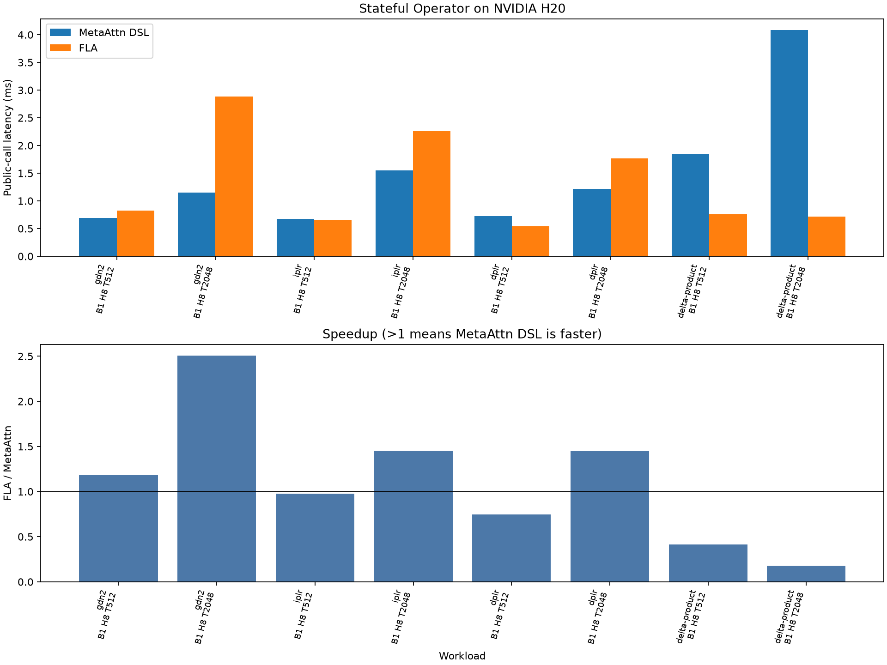

# Mathematical structure recovery on H20

Integration update: this document records the original experiment. The merged
implementation subsequently normalizes proved matrix readouts before planning,
uses the shared weighted outer-product recipe, and supports its zero-safe scalar
VJP. Delta Product can therefore use compiled factored backward. CPU, packed,
and unoptimized calls select paths from the normalized program's capabilities.
See [readout normalization and precision measurements](measurements/readout-normalization-h20/README.md)
and [weighted-write measurements](measurements/weighted-outer-products-h20/README.md)
for the subsequent results.

This experiment recovers low-rank execution for GDN2, IPLR, DPLR and Delta
Product without changing the authored examples or the public IR. All eight
long-sequence comparison points pass the independent FP32 token oracle and
FLA output checks. The four families now execute within the default 1 GiB
workspace limit instead of requiring the previous 8 GiB limit.

The experiment lives in the remote worktree
`allinai2plus:/dev/shm/metaattention-math-structured`, branch
`perf/math-structured-recipes`, based on `c9d7acc`. The original worktree remains
on `perf/structured-lowering`. The implementation follows the first two steps
of the [execution-path proposal](stateful-specialized-paths.md).

## Implementation

The analyzer extends `RankOneFactoredIR` with a complete recipe for ordered
propagations, injections and simple readouts. A post-transition
`Readout(StateTerm(...))` is recognized as a contraction when its entire
expression is that term, its operand is state-free, and its axis matches the
matrix recurrence. Prior-state terms, nonlinear readouts, shifts and multi-state
programs retain their existing fallback. The authored Algorithm IR is unchanged.

An injection recipe contains two disjoint vector factors followed by ordered
feature-free factors. The executor consumes the recipe, rather than requiring
exactly two factors or reinterpreting the original readout nodes. This admits
the expanded Delta Product writes. In the TileLang summary and replay kernels,
the product is evaluated as `((left * right) * weight_0) * weight_1 ...` in FP32.
Weights are not folded into BF16 vectors or multiplied together in advance.
The kernel still performs the recurrence's normal chunk composition; this is
not a claim of bitwise equality with sequential recurrence execution.

The recovered simple readouts reuse both inference and checkpointed backward.
The backward factor packer now broadcasts scalar propagation coefficients,
which are used by GDN2, IPLR and DPLR. Weighted injection backward remains on
reference execution: its new coefficient VJP is not implemented here. CPU,
packed and explicitly unoptimized calls retain the existing reference behavior
for these recovered examples. Dense empty sequences remain rejected by the
public shape contract.

The existing schedules remain in use: IPLR admits compact WY; GDN2/DPLR use
ordered affine chunk summaries; Delta Product uses ordered chunk summaries
with weighted writes. Its two propagation events and three expanded writes
still exceed the current four-event WY limit. The workspace estimate includes
the padded coefficient storage. No model-name dispatch was introduced.

## Results

Measured on otherwise idle H20 GPU 0, B=1, H=8, K=V=64, BF16 data and FP32
gates/state, zero initial state, output-only, five warmups and twenty
repetitions. Compilation is excluded; public-call preparation and FLA adapters
are included. All rows select `tilelang-factored-recurrence`.

| Family | T | Meta public ms | FLA public ms | Meta Graph ms | Meta allocation MiB |
| --- | ---: | ---: | ---: | ---: | ---: |
| GDN2 | 512 | 0.694 | 0.822 | 0.251 | 17.2 |
| GDN2 | 2048 | 1.152 | 2.886 | 0.739 | 68.3 |
| IPLR | 512 | 0.673 | 0.656 | 0.338 | 24.2 |
| IPLR | 2048 | 1.553 | 2.258 | 1.253 | 96.3 |
| DPLR | 512 | 0.725 | 0.542 | 0.251 | 17.2 |
| DPLR | 2048 | 1.220 | 1.768 | 0.747 | 68.3 |
| Delta Product | 512 | 1.844 | 0.759 | 1.101 | 28.4 |
| Delta Product | 2048 | 4.081 | 0.718 | 3.510 | 113.1 |

Allocation is the peak incremental PyTorch allocation during a warmed call.
Complete [records](measurements/math-structured-h20/records.json),
[manifest](measurements/math-structured-h20/manifest.json) and
[CSV](measurements/math-structured-h20/summary.csv) preserve correctness errors,
public/Graph/wall timing, allocation and profiler diagnostics.

Relative to the earlier [benchmark](stateful-example-benchmarks.md), T=2048
public latency improves from 46.050 to 1.152 ms for GDN2, 45.406 to 1.553 ms for
IPLR, 46.035 to 1.220 ms for DPLR, and 49.251 to 4.081 ms for Delta Product.
Those are historical comparisons, not interleaved old/new timings. Incremental
allocation drops from 3328 MiB per family to 68–113 MiB. Current-run FLA
comparisons favor the first three families at T=2048. Delta Product remains
about 5.7 times slower than FLA's chunk API, particularly in Graph replay.



FLA uses fused recurrent APIs for GDN2/IPLR/DPLR and a chunk API for Delta
Product, from revision `f3bec720f7847d4f176872b34f002cc580e2cc6e`. These results
do not establish parity with the fastest FLA prefill kernels for the other
families, or training performance. PyTorch is 2.11.0+cu128, CUDA 12.8 and TileLang
0.1.15. The manifest identifies the actual measured Python sources, including
the worktree changes, rather than just its base commit.

## Chunk experiment

A separate input-fixed [probe](measurements/math-structured-h20/chunk_probe.py)
compares 16, 32, 64 and 128-token replay chunks at T=2048, requesting output and
final state. All twelve points pass the independent oracle. This prototype
replaces only the chunk choice in the in-memory forward function; it does not
modify production source. It is tied to this checkpoint implementation and
writes its result to `/tmp/meta_math_chunk_probe.json`.

Delta Product public medians are 4.854, 4.478, 4.166 and 4.811 ms respectively;
Graph medians are 3.735, 3.418, 3.478 and 4.179 ms. GDN2/DPLR show small Graph
improvements with 128-token chunks but inconsistent public-call ordering.
This single-shape experiment does not justify a new default. The implementation
keeps the existing 64-token long-inference schedule. Raw
[chunk records](measurements/math-structured-h20/chunk-probe.json) preserve
these exploratory results separately from the final FLA comparison.

## Validation and remaining work

- Full CPU suite: 278 passed, 59 skipped. The skips include opt-in GPU tests.
- Example and recipe tests with GPU enabled: 93 passed, 9 skipped. The nine
  skips are combinations of three-write testing with families other than Delta
  Product. All nine original GPU forward and gradient cases pass.
- Recovered GPU contracts cover grouped heads, K=64/V=128, nonzero initial
  state, 17/65-token tails and continuation; Delta Product covers two and three
  ordered writes. Six additional FP32/BF16 backward cases use B=2 and T=17,
  crossing a training checkpoint boundary with bounded low-rank inputs. CPU
  oracle tests retain zero-state and gradient coverage.
- An adversarial weighted-write test stays finite in authored multiplication
  order but would overflow if a scalar were folded into the right vector. This
  checks the real public executor's coefficient handling.
- Eight final benchmark points and twelve chunk-probe points pass independent
  output checks; the chunk probe also checks final state. Ruff and diff checks
  pass.

A stress probe that repeats unrestricted random IPLR maps at B=2/T=17 exceeds
its BF16 gradient tolerance in both the original reference path and the recovered
path. The key/alpha/beta gradient differences against the oracle are identical
between those paths for that probe, while FP32 checks pass. This is a numerical
limit of that unbounded workload, not evidence that all BF16 training shapes
are validated. The regression cases bound the independent low-rank vectors as
the long-sequence benchmark does. The
[diagnostic log](measurements/math-structured-h20/gradient-diagnosis.txt) records
both paths and dtypes without widening the existing tolerances.

Oja's independent update/readout axes and ABC's public-call overhead are not
changed in this experiment. Next work should target Delta Product's compact
write composition/event schedule, then Oja's orientation-aware state tiling.
Weighted backward needs its own coefficient VJP and numerical validation before
it can leave reference execution.

## Reproduce

Use the existing environment while forcing imports from this worktree:

```bash
cd /dev/shm/metaattention-math-structured
export PYTHONPATH="$PWD/attention_engine:$PWD"
/mnt/nvme/linyanxuan/MetaAttentionImpl/.venv/bin/python \
  testing/benchmark_fla_stateful.py \
  --families gdn2,iplr,dplr,delta-product \
  --batches 1 --heads 8 --seqlens 512 2048 \
  --contract output-only --timing both --warmup 5 --repetitions 20 \
  --workspace-gib 1 --gpu 0 \
  --fla-source /mnt/nvme/linyanxuan/flash-linear-attention \
  --output-dir benchmark_results/math_structured_h20_final
```

Run `python -m pytest tests/unit` in the same environment for the CPU suite.
On an idle GPU, use `--run-gpu` with
`tests/unit/test_stateful_factored_recipes.py` and
`tests/unit/test_delta_family_examples.py` for the GPU checks.
