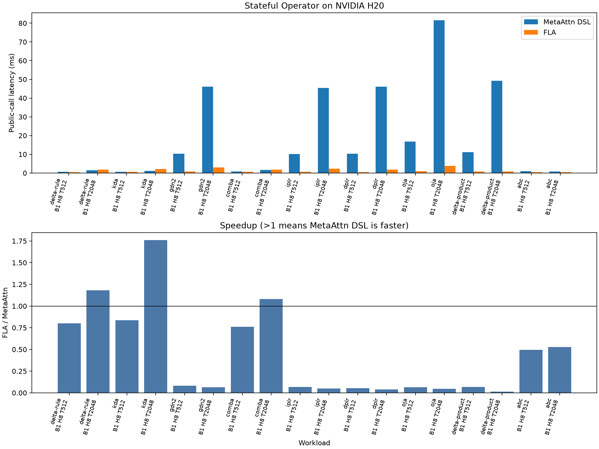

# Stateful example benchmarks on H20

All 18 forward comparison points passed the independent FP32 token oracle and
pairwise output checks. At T=2048, the public-call measurements show Delta Rule,
KDA and ComBa faster than the FLA fused recurrent baselines. ABC has similar
CUDA Graph latency to FLA's chunk implementation, but higher public-call
latency. GDN2, IPLR, DPLR and Delta Product select the reference path; Oja selects
a dense product/GEMM path. These paths remain substantially slower and use
much more memory than their FLA baselines.

## Workload and measurement

- Device: otherwise idle NVIDIA H20, physical GPU 0; idle selection is recorded
  in the [manifest](measurements/stateful-examples-h20/manifest.json).
- Shapes: B=1, H=8, T in {512, 2048}, K=V=64, 16 ABC slots, two Delta Product
  writes per token. Inputs start from zero state and request output only.
- BF16 query/key/value; FP32 gates and states. Inputs use normalized correction
  vectors and small independent IPLR/DPLR low-rank vectors to avoid unstable
  random state maps. ABC logits are exactly BF16-representable FP32 values.
- Five warmups and 20 repetitions; each timing is a median. Compilation is
  excluded; tensor layout conversion and baseline semantic adjustments are
  included. Public calls, synchronized wall time and Graph replay are distinct
  metrics. Measurements are sequential Meta then FLA, not interleaved; small
  differences such as ComBa's 1.08x public-call ratio merit repeated measurement.
- Meta workspace budget: 8 GiB, a limit rather than a reservation. The default
  1 GiB budget rejected T=2048 for GDN2, IPLR, DPLR, Oja and Delta Product.
- Environment: PyTorch 2.11.0+cu128, CUDA 12.8, TileLang 0.1.15. FLA loaded from
  the adjacent checkout at `f3bec720f7847d4f176872b34f002cc580e2cc6e`, rather
  than inferred from installed package metadata.
- Meta base commit: `9e71baefd975c7bb5475d657ea3c88a2b6ccce51` plus the benchmark
  changes in this submission. Measured Python source SHA256:
  `8c9fbd73b3ae5afd437e2082de9068df0a39853068906dd5aa09bae19da7778f`.

This benchmark measures forward inference and compares FLA's public fused
recurrent APIs, except Delta Product and ABC, which use chunk APIs. It does not
establish performance against the fastest FLA prefill kernels or training
backward. Complete [records](measurements/stateful-examples-h20/records.json)
and [CSV](measurements/stateful-examples-h20/summary.csv) include selected
lowerers, correctness errors, synchronized wall time, Graph-capture errors,
allocator peaks, and available profiler diagnostics.

## Public-call CUDA event latency

All times are milliseconds; the ratio is FLA / Meta, so values above 1 favor Meta.

| Family | T | Meta ms | FLA ms | FLA / Meta |
| --- | ---: | ---: | ---: | ---: |
| delta-rule | 512 | 0.678 | 0.542 | 0.80x |
| delta-rule | 2048 | 1.564 | 1.850 | 1.18x |
| kda | 512 | 0.735 | 0.615 | 0.84x |
| kda | 2048 | 1.184 | 2.083 | 1.76x |
| gdn2 | 512 | 10.236 | 0.828 | 0.08x |
| gdn2 | 2048 | 46.050 | 2.902 | 0.06x |
| comba | 512 | 0.758 | 0.576 | 0.76x |
| comba | 2048 | 1.647 | 1.778 | 1.08x |
| iplr | 512 | 10.082 | 0.665 | 0.07x |
| iplr | 2048 | 45.406 | 2.271 | 0.05x |
| dplr | 512 | 10.252 | 0.556 | 0.05x |
| dplr | 2048 | 46.035 | 1.782 | 0.04x |
| oja | 512 | 16.800 | 1.054 | 0.06x |
| oja | 2048 | 81.474 | 3.858 | 0.05x |
| delta-product | 512 | 11.125 | 0.751 | 0.07x |
| delta-product | 2048 | 49.251 | 0.750 | 0.02x |
| abc | 512 | 0.943 | 0.467 | 0.50x |
| abc | 2048 | 0.891 | 0.470 | 0.53x |



## Execution paths and Graph replay at T=2048

Graph times are milliseconds. A dash means capture failed and no Graph ratio
is reported. Memory is peak incremental PyTorch allocation during a warmed
public invocation, in MiB; allocator totals are available in the raw records.

| Family | Meta lowerer | Meta Graph ms | FLA Graph ms | Meta / FLA memory MiB |
| --- | --- | ---: | ---: | ---: |
| delta-rule | `tilelang-factored-recurrence` | 1.238 | 1.767 | 92.3 / 10.1 |
| kda | `tilelang-factored-recurrence` | 0.756 | 1.986 | 68.4 / 12.1 |
| gdn2 | `reference-stateful` | — | 2.815 | 3328.0 / 20.0 |
| comba | `tilelang-factored-recurrence` | 1.264 | 1.662 | 96.5 / 16.2 |
| iplr | `reference-stateful` | — | 2.170 | 3328.0 / 16.0 |
| dplr | `reference-stateful` | — | 1.672 | 3328.0 / 16.0 |
| oja | `tilelang-product-gemm` | 80.917 | 3.759 | 4100.1 / 12.1 |
| delta-product | `reference-stateful` | — | 0.224 | 3328.0 / 38.5 |
| abc | `tilelang-chunked-stateful` | 0.208 | 0.235 | 26.1 / 23.5 |

## Adapter and state contracts

ComBa's FLA fused kernel in this checkout predicts using the prior state,
whereas its naive implementation and the example predict using the decayed
state. The adapter multiplies the FLA prediction key by `exp(gate)` in FP32,
inside the timed interval. This produces the example's recurrence without an
additional BF16 rounding of that product. Both long-sequence points and a
separate B=H=1, T=65 output/final-state/continuation check passed after adjustment.

FLA ABC's chunk dot products require BF16 slot logits alongside BF16 key/value.
The workload generates exactly BF16-representable values, stores them in Meta's
FP32 input and casts them for FLA inside the timed interval. ABC final-state and
continuation are marked `NOT_COMPARABLE`: Meta carries three raw accumulators
while FLA exposes two normalized caches. Meta's own output, final state and
continuation still pass the independent oracle at B=H=1, T=65. The other eight
families passed all three contracts at that short shape.

The reference paths fail CUDA Graph capture; their ordinary public-call results
remain valid and include the reference implementation's GPU tensor operations.
No engine optimization was introduced in this benchmark addition.

## Reproduce

From the repository root with the same optional FLA dependencies:

```bash
uv run --group fla-benchmark python testing/benchmark_fla_stateful.py \
  --families delta-rule,kda,gdn2,comba,iplr,dplr,oja,delta-product,abc \
  --batches 1 --heads 8 --seqlens 512 2048 \
  --contract output-only --timing both --warmup 5 --repetitions 20 \
  --workspace-gib 8 --fla-source ../flash-linear-attention \
  --gpu 0 --output-dir benchmark_results/new_examples_h20_8gib
```

For short-shape state checks, use `--heads 1 --seqlens 65 --contract all`.
For Meta-only measurements, the same families are registered in
`testing/benchmark_stateful_plans.py`. See the
[example guide](../examples/README.md#benchmark-against-fla) for input preparation
and API conventions.
